# 🏨 Booking App

A RESTful booking application built with **Spring Boot 3**, enabling users to browse accommodations, make bookings, and process payments — with real-time Telegram notifications and Stripe integration.

---

## 📖 Table of Contents

- [Overview](#overview)
- [Tech Stack](#tech-stack)
- [Architecture](#architecture)
- [Domain Models](#domain-models)
- [Features](#features)
- [Getting Started](#getting-started)
- [Environment Variables](#environment-variables)
- [API Reference](#api-reference)
- [Security](#security)
- [Database Schema](#database-schema)
- [Notifications](#notifications)
- [Tests](#tests)
- [Swagger-UI](#swagger-ui)

---

## Overview

Booking App is a backend REST API that allows:

- **Customers** to register, browse accommodations, create bookings, and pay via Stripe
- **Managers** to manage accommodations, amenities, and monitor all bookings and payments
- **Admins** to receive real-time Telegram notifications about new and canceled bookings

The API is documented with **Swagger / OpenAPI** and is accessible at `/booking-api/swagger-ui.html` when running.

---

## Tech Stack

| Category | Technology |
|---|---|
| Language | Java 17 |
| Framework | Spring Boot 3.2.4 |
| Security | Spring Security + JWT (jjwt 0.12.5) |
| Database | PostgreSQL |
| Migrations | Liquibase |
| ORM | Spring Data JPA / Hibernate |
| Mapping | MapStruct 1.5.5 |
| Payments | Stripe Java SDK 25.7.0 |
| Notifications | Telegram Bots (telegrambots 5.5.0) |
| API Docs | SpringDoc OpenAPI 2.2.0 |
| Validation | Hibernate Validator |
| Boilerplate | Lombok |
| Testing | JUnit 5, Testcontainers, Spring Security Test |
| Build | Maven + Checkstyle |

---

## Architecture

The application follows a standard layered architecture:

```
Controller → Service → Repository → Database
                ↓
          Mapper (MapStruct)
                ↓
            DTO Layer
```

### **Architecture Diagram**
A layered box diagram showing the architecture of the project with side APIs.
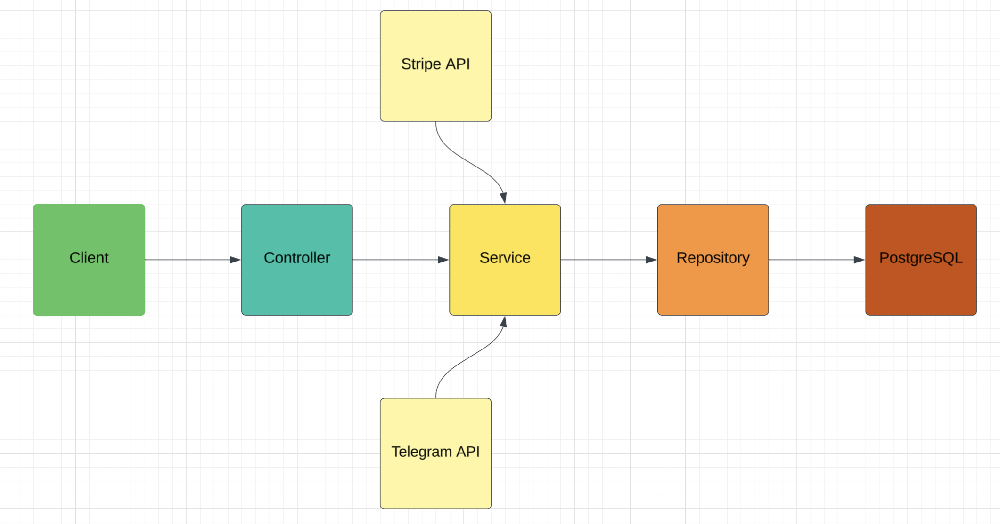

**Key packages:**

- `controller` — REST endpoints (AccommodationController, AmenityController, AuthenticationController, BookingController, PaymentController)
- `service` — Business logic (with `Impl` classes)
- `repository` — Spring Data JPA repositories + Specification pattern for dynamic search
- `model` — JPA entities (Accommodation, Amenity, Booking, Payment, User, Role)
- `dto` — Request/Response DTOs per domain
- `mapper` — MapStruct mappers
- `security` — JWT filter, CustomUserDetailsService, AuthenticationService
- `config` — SecurityConfig, StripeConfig, TelegramBotConfig, OpenApiConfig
- `client` — StripeClient, MyTelegramBot
- `validation` — Custom validators (Email, AccommodationType)
- `exception` — Global exception handler

---

## Domain Models

### Accommodation
| Field | Type | Notes |
|---|---|---|
| id | Long | Primary key |
| type | Enum | `HOUSE`, `APARTMENT`, `CONDO`, `VACATION_HOME` |
| location | String | Address / area |
| size | String | e.g. "2BR", "Studio" |
| dailyRate | BigDecimal | Price per night |
| availability | Integer | Number of units available |
| amenities | Set\<Amenity\> | Many-to-many |
| isDeleted | boolean | Soft delete |

### Booking
| Field | Type | Notes |
|---|---|---|
| id | Long | Primary key |
| checkInDate | LocalDate | |
| checkOutDate | LocalDate | |
| accommodation | Accommodation | FK |
| user | User | FK |
| status | Enum | `PENDING`, `CONFIRMED`, `CANCELED`, `EXPIRED` |
| isDeleted | boolean | Soft delete |

### Payment
| Field | Type | Notes |
|---|---|---|
| id | Long | Primary key |
| booking | Booking | FK |
| user | User | FK |
| sessionUrl | String | Stripe checkout URL |
| sessionId | String | Stripe session ID |
| amount | BigDecimal | |
| status | Enum | `PENDING`, `PAID`, `EXPIRED`, `CANCELED` |
| isDeleted | boolean | Soft delete |

### User
| Field | Type |
|---|---|
| id | Long |
| email | String (unique) |
| password | String (encoded) |
| firstName | String |
| lastName | String |
| roles | Set\<Role\> |

### Role
Roles: `CUSTOMER`, `MANAGER`

### Amenity
| Field | Type |
|---|---|
| id | Long |
| name | String |
| description | String |

---

## Features

### Accommodation Management
- Create, read, update, and soft-delete accommodations (MANAGER only)
- List all accommodations with pagination
- Filter accommodations by amenity
- Dynamic search by type, location, daily rate range, and minimum availability

### Amenity Management
- Full CRUD for amenities (create/update/delete restricted to MANAGER)
- Publicly viewable

### User Authentication
- Register with email + password (custom email validation)
- Login returns a signed JWT token
- JWT-based stateless authentication on all protected endpoints

### Booking Management
- Customers can create, view, update, and delete their own bookings
- Booking creation automatically decrements accommodation availability
- Managers can query any user's bookings by user ID and status
- Managers can update booking status (PATCH)
- Expired booking detection via scheduled job
#### Booking Flow Diagram
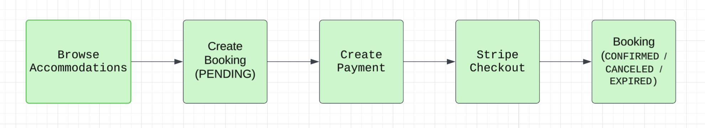

### Payment Processing (Stripe)
- Create a Stripe Checkout Session linked to a booking
- Redirect-based success and cancel flows
- Renew expired payment sessions
- View payment history (own for customers, any user for managers)
- Prevents booking if unpaid bookings exist (`UnpaidBookingException`)
#### Payment Flow Diagram
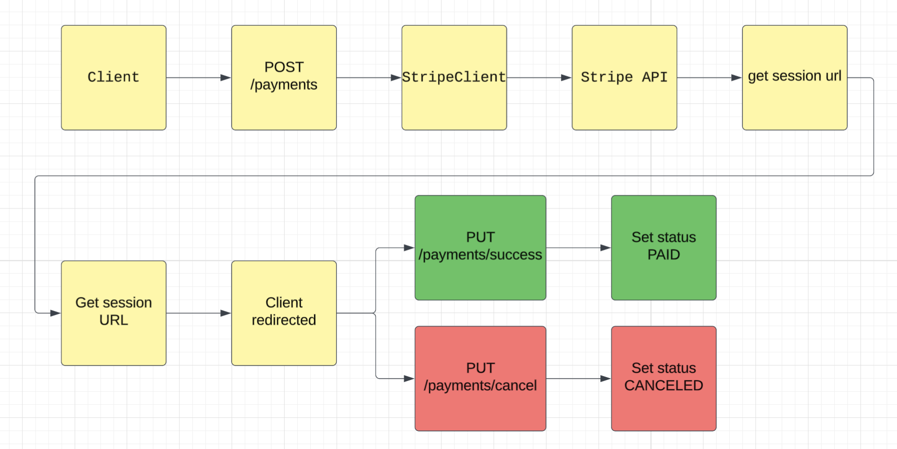

### Notifications (Telegram)
- Manager receives a Telegram message when a booking is created or canceled
- Configured via bot token, username, and admin chat ID

---

## Getting Started

### Prerequisites

- Java 17+
- Maven 3.8+
- Docker & Docker Compose (for PostgreSQL)
- A Stripe account (test mode is fine)
- A Telegram bot token (via [@BotFather](https://t.me/BotFather))

### Clone & Run

```bash
git clone https://github.com/your-username/booking-app.git
cd booking-app
```

Create a `.env` file in the project root (see [Environment Variables](#environment-variables)).

Start the database:

```bash
docker-compose up -d
```

Build and run:

```bash
mvn clean install
java -jar target/booking-app-0.0.1-SNAPSHOT.jar
```

The API will be available at: `http://localhost:8080/booking-api`

Swagger UI: `http://localhost:8080/booking-api/swagger-ui.html`

---

## Environment Variables

Create a `.env` file in the project root:

```env
# Database
SPRING_DATASOURCE_URL=jdbc:postgresql://localhost:5432/booking_db
SPRING_DATASOURCE_USERNAME=your_db_user
SPRING_DATASOURCE_PASSWORD=your_db_password

# JWT
JWT_SECRET_STRING=your_very_long_secret_key_here

# Stripe
STRIPE_API_KEY=sk_test_...

# Telegram
TELEGRAM_BOT_TOKEN=your_telegram_bot_token
TELEGRAM_BOT_USERNAME=your_bot_username
ADMIN_CHAT_ID=your_telegram_chat_id
```

> JWT tokens expire after `3,000,000` milliseconds (~50 minutes) by default.

---

## API Reference

The base path for all endpoints is `/booking-api`.

_You can call POST, PUT, PATCH, GET, DELETE requests using this application. All endpoints are listed in the following table:_

<body>
<table>
  <thead>
    <tr>
      <th>Action</th>
      <th>Request Type</th>
      <th>Path</th>
      <th>RequestDTO</th>
      <th>ResponseDTO</th>
      <th>Required Authority</th>
    </tr>
  </thead>
  <tbody>
    <!-- Authentication -->
    <tr>
      <td>Register new User</td>
      <td>POST</td>
      <td>/booking-api/auth/register</td>
      <td>RegistrationRequestDto</td>
      <td>RegistrationResponseDto</td>
      <td>PUBLIC</td>
    </tr>
    <tr>
      <td>User Login</td>
      <td>POST</td>
      <td>/booking-api/auth/login</td>
      <td>LoginRequestDto</td>
      <td>LoginResponseDto</td>
      <td>PUBLIC</td>
    </tr>
    <!-- Accommodation -->
    <tr>
      <td>Create new Accommodation</td>
      <td>POST</td>
      <td>/booking-api/accommodations</td>
      <td>AccommodationRequestDto</td>
      <td>AccommodationResponseDto</td>
      <td>MANAGER</td>
    </tr>
    <tr>
      <td>Get an Accommodation</td>
      <td>GET</td>
      <td>/booking-api/accommodations/{id}</td>
      <td><i>EMPTY</i></td>
      <td>AccommodationResponseDto</td>
      <td>CUSTOMER</td>
    </tr>
    <tr>
      <td>Get all Accommodations</td>
      <td>GET</td>
      <td>/booking-api/accommodations</td>
      <td><i>EMPTY</i></td>
      <td>List&lt;AccommodationResponseDto&gt;</td>
      <td>CUSTOMER</td>
    </tr>
    <tr>
      <td>Get Accommodations by AmenityId</td>
      <td>GET</td>
      <td>/booking-api/accommodations/amenity/{amenityId}</td>
      <td><i>EMPTY</i></td>
      <td>List&lt;AccommodationWithoutAmenityIdsDto&gt;</td>
      <td>CUSTOMER</td>
    </tr>
    <tr>
      <td>Search Accommodations</td>
      <td>GET</td>
      <td>/booking-api/accommodations/search</td>
      <td>AccommodationSearchParameters</td>
      <td>List&lt;AccommodationResponseDto&gt;</td>
      <td>CUSTOMER</td>
    </tr>
    <tr>
      <td>Update Accommodation</td>
      <td>PUT</td>
      <td>/booking-api/accommodations/{id}</td>
      <td>AccommodationRequestDto</td>
      <td>AccommodationResponseDto</td>
      <td>MANAGER</td>
    </tr>
    <tr>
      <td>Delete Accommodation</td>
      <td>DELETE</td>
      <td>/booking-api/accommodations/{id}</td>
      <td><i>EMPTY</i></td>
      <td><i>EMPTY</i></td>
      <td>MANAGER</td>
    </tr>
    <!-- Amenity -->
    <tr>
      <td>Create new Amenity</td>
      <td>POST</td>
      <td>/booking-api/amenities</td>
      <td>AmenityRequestDto</td>
      <td>AmenityResponseDto</td>
      <td>MANAGER</td>
    </tr>
    <tr>
      <td>Get an Amenity</td>
      <td>GET</td>
      <td>/booking-api/amenities/{id}</td>
      <td><i>EMPTY</i></td>
      <td>AmenityResponseDto</td>
      <td>CUSTOMER</td>
    </tr>
    <tr>
      <td>Get all Amenities</td>
      <td>GET</td>
      <td>/booking-api/amenities</td>
      <td><i>EMPTY</i></td>
      <td>List&lt;AmenityResponseDto&gt;</td>
      <td>CUSTOMER</td>
    </tr>
    <tr>
      <td>Update Amenity</td>
      <td>PUT</td>
      <td>/booking-api/amenities/{id}</td>
      <td>AmenityRequestDto</td>
      <td>AmenityResponseDto</td>
      <td>MANAGER</td>
    </tr>
    <tr>
      <td>Delete Amenity</td>
      <td>DELETE</td>
      <td>/booking-api/amenities/{id}</td>
      <td><i>EMPTY</i></td>
      <td><i>EMPTY</i></td>
      <td>MANAGER</td>
    </tr>
    <!-- Booking -->
    <tr>
      <td>Create new Booking</td>
      <td>POST</td>
      <td>/booking-api/bookings</td>
      <td>BookingRequestDto</td>
      <td>BookingResponseDto</td>
      <td>CUSTOMER</td>
    </tr>
    <tr>
      <td>Get a Booking</td>
      <td>GET</td>
      <td>/booking-api/bookings/{id}</td>
      <td><i>EMPTY</i></td>
      <td>BookingResponseDto</td>
      <td>CUSTOMER</td>
    </tr>
    <tr>
      <td>Get my Bookings</td>
      <td>GET</td>
      <td>/booking-api/bookings/my</td>
      <td><i>EMPTY</i></td>
      <td>List&lt;BookingResponseDto&gt;</td>
      <td>CUSTOMER</td>
    </tr>
    <tr>
      <td>Update Booking</td>
      <td>PUT</td>
      <td>/booking-api/bookings/{id}</td>
      <td>BookingRequestDto</td>
      <td>BookingResponseDto</td>
      <td>CUSTOMER</td>
    </tr>
    <tr>
      <td>Get Bookings by Status and UserId</td>
      <td>GET</td>
      <td>/booking-api/bookings?user_id={id}&amp;status={status}</td>
      <td><i>EMPTY</i></td>
      <td>List&lt;BookingResponseDto&gt;</td>
      <td>MANAGER</td>
    </tr>
    <tr>
      <td>Update Status of Booking</td>
      <td>PATCH</td>
      <td>/booking-api/bookings/{id}</td>
      <td>UpdateStatusDto</td>
      <td><i>EMPTY</i></td>
      <td>MANAGER</td>
    </tr>
    <tr>
      <td>Delete Booking</td>
      <td>DELETE</td>
      <td>/booking-api/bookings/{id}</td>
      <td><i>EMPTY</i></td>
      <td><i>EMPTY</i></td>
      <td>CUSTOMER</td>
    </tr>
    <!-- Payment -->
    <tr>
      <td>Create new Payment</td>
      <td>POST</td>
      <td>/booking-api/payments</td>
      <td>PaymentRequestDto</td>
      <td>PaymentResponseDto</td>
      <td>CUSTOMER</td>
    </tr>
    <tr>
      <td>Successful Payment</td>
      <td>PUT</td>
      <td>/booking-api/payments/success?session_id={id}</td>
      <td><i>EMPTY</i></td>
      <td>PaymentResponseDto</td>
      <td>CUSTOMER</td>
    </tr>
    <tr>
      <td>Cancel Payment</td>
      <td>PUT</td>
      <td>/booking-api/payments/cancel?session_id={id}</td>
      <td><i>EMPTY</i></td>
      <td>String</td>
      <td>CUSTOMER</td>
    </tr>
    <tr>
      <td>Renew Payment</td>
      <td>POST</td>
      <td>/booking-api/payments/renew?session_id={id}</td>
      <td><i>EMPTY</i></td>
      <td>PaymentResponseDto</td>
      <td>CUSTOMER</td>
    </tr>
    <tr>
      <td>Get my Payments</td>
      <td>GET</td>
      <td>/booking-api/payments/my</td>
      <td><i>EMPTY</i></td>
      <td>List&lt;PaymentResponseDto&gt;</td>
      <td>CUSTOMER</td>
    </tr>
    <tr>
      <td>Get Payments for certain User</td>
      <td>GET</td>
      <td>/booking-api/payments?user_id={id}</td>
      <td><i>EMPTY</i></td>
      <td>List&lt;PaymentResponseDto&gt;</td>
      <td>MANAGER</td>
    </tr>
  </tbody>
</table>
</body>

---

## Security

Authentication is handled via **JWT Bearer tokens**.

1. Register at `POST /auth/register` or login at `POST /auth/login`
2. Copy the `token` value from the response
3. Add it to all subsequent requests as a header:
   ```
   Authorization: Bearer <your_token_here>
   ```
#### JWT Auth Flow Diagram
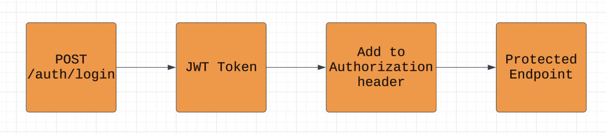

**Role hierarchy:**

| Role | Can do |
|---|---|
| PUBLIC | Register, Login |
| CUSTOMER | Browse accommodations & amenities, manage own bookings & payments |
| MANAGER | Everything CUSTOMER can do + manage accommodations, amenities, view all bookings/payments |

Passwords are stored using **BCrypt** encoding. Custom email validation is enforced on registration.

---

## Database Schema

Managed by **Liquibase** with YAML changelogs. Tables created in order:

1. `accommodations` — type, location, size, daily_rate, availability, is_deleted
2. `amenities` — name, description, is_deleted
3. `accommodation_amenity` — join table (many-to-many)
4. `users` — email, password, first_name, last_name, is_deleted
5. `roles` — role_name enum
6. `user_role` — join table
7. `bookings` — check_in_date, check_out_date, status, accommodation_id, user_id, is_deleted
8. `payments` — status, booking_id, user_id, session_url, session_id, amount, is_deleted

All entities use **soft delete** (`is_deleted` flag) rather than physical row removal.

### **LogiPhysical Model**

This is a **LogiPhysical** model representing the __booking__ database with entities and corresponding cardinalities.

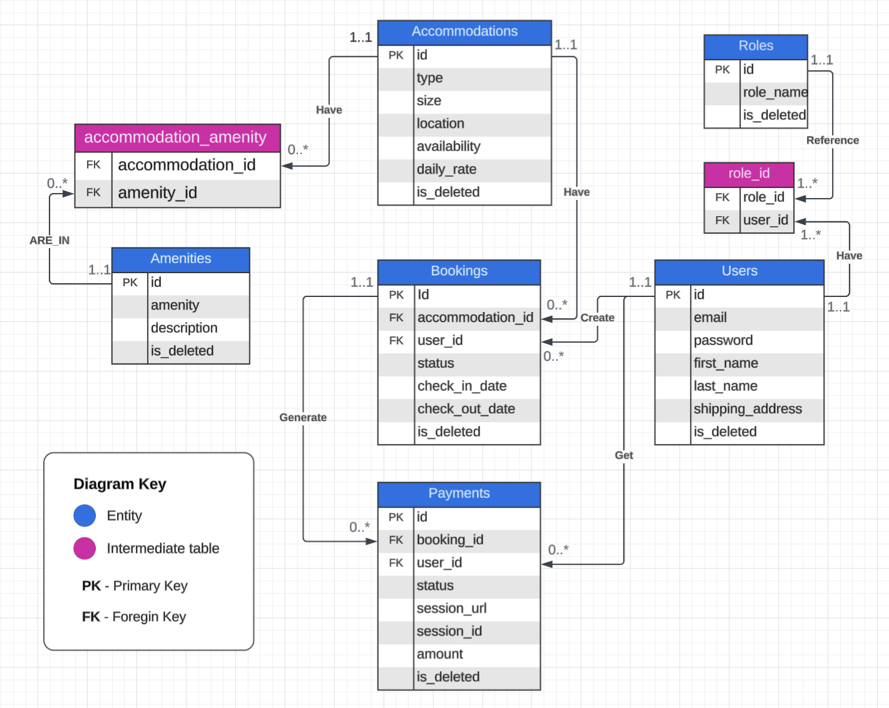

---

## Notifications

The app integrates a **Telegram Bot** that sends messages to a configured admin chat when:

- A new booking is created
- A booking is canceled or expires

Configure the bot in your `.env` file using the `TELEGRAM_BOT_TOKEN`, `TELEGRAM_BOT_USERNAME`, and `ADMIN_CHAT_ID` variables. The chat ID can be obtained by messaging your bot and querying the Telegram Bot API's `getUpdates` endpoint.
### Examples for some notifications
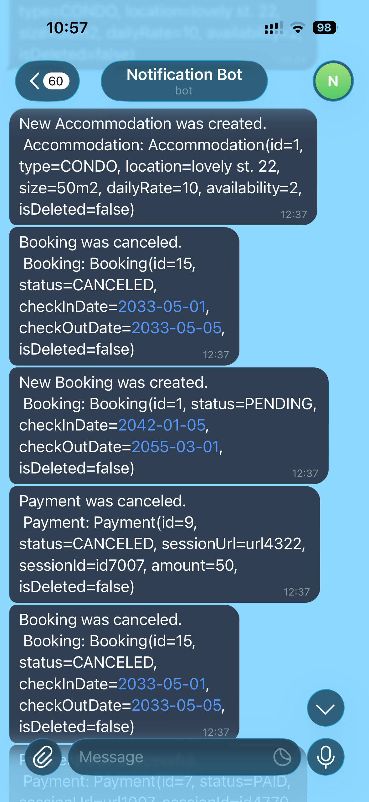

---

## Tests

The project has three layers of automated tests covering controllers, services, and repositories. All tests run against a real PostgreSQL instance managed by **Testcontainers**, ensuring they reflect actual database behaviour rather than in-memory approximations.

To run all tests:

```bash
mvn test
```


### Controller Tests (Integration)

All controller tests use `@SpringBootTest(webEnvironment = RANDOM_PORT)` with a full Spring context, `MockMvc` wired through `springSecurity()`, and SQL scripts to seed/clean the database before and after each test. Authentication is handled via `@WithMockUser` for role-based endpoints, and via `SecurityContextHolder` injection for endpoints that read the currently authenticated user (e.g. `GET /bookings/my`).


### Service Tests (Unit)

Service tests use `@ExtendWith(MockitoExtension.class)` with `@Mock` for all dependencies and `@InjectMocks` for the implementation. No Spring context is loaded, making them fast and isolated. All collaborators are verified with `verifyNoMoreInteractions()` after each test.


### Repository Tests (Slice)

Repository tests use `@DataJpaTest` with `@AutoConfigureTestDatabase(replace = NONE)`, running against the real Testcontainers PostgreSQL instance. SQL scripts seed data at class or method level via `@Sql` annotations.


### Test Coverage
There are 83 tests that cover over 81% code lines of the whole application!
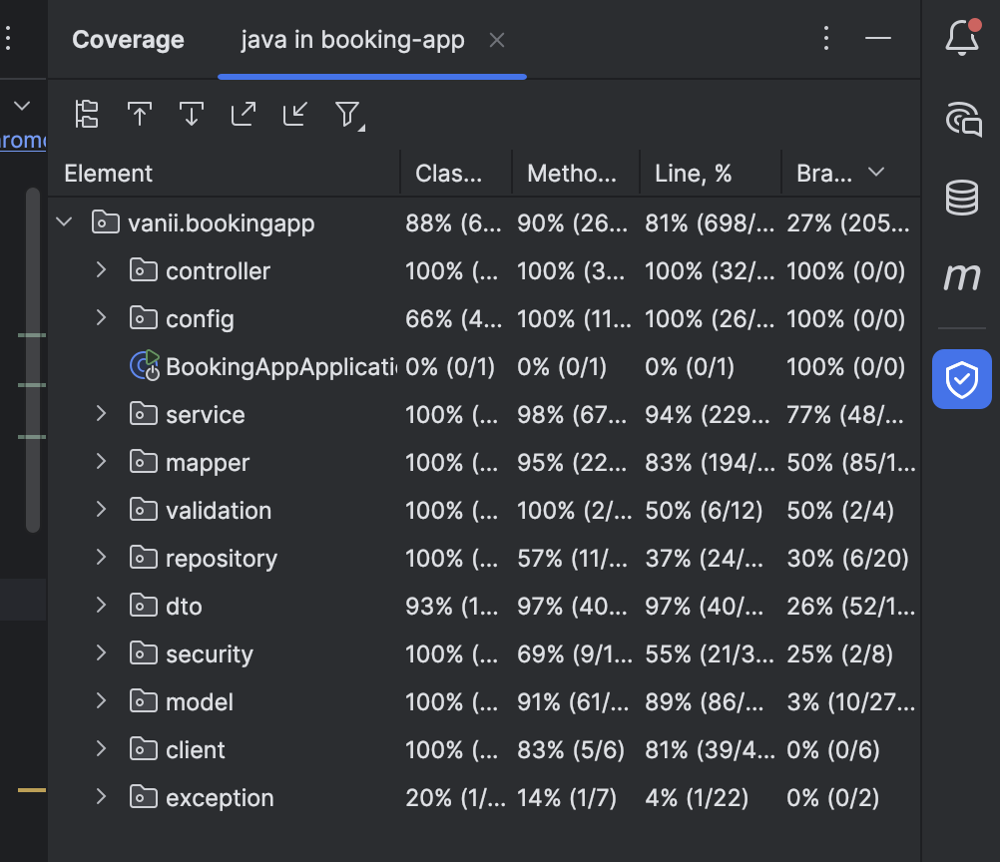

---

## Swagger-UI

To be able to use a booking API in a convenient way, the swagger-ui was added. If the user forwards to 
localhost:${SPRING_LOCAL_PORT}/booking-api/swagger-ui/index.html/ then the useful interface with full documentation appears.
Here are some screenshot examples:

### User registration
**Input**
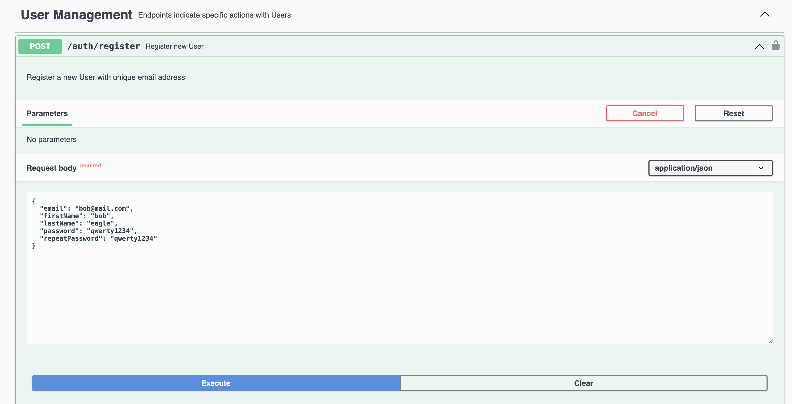
**Output**
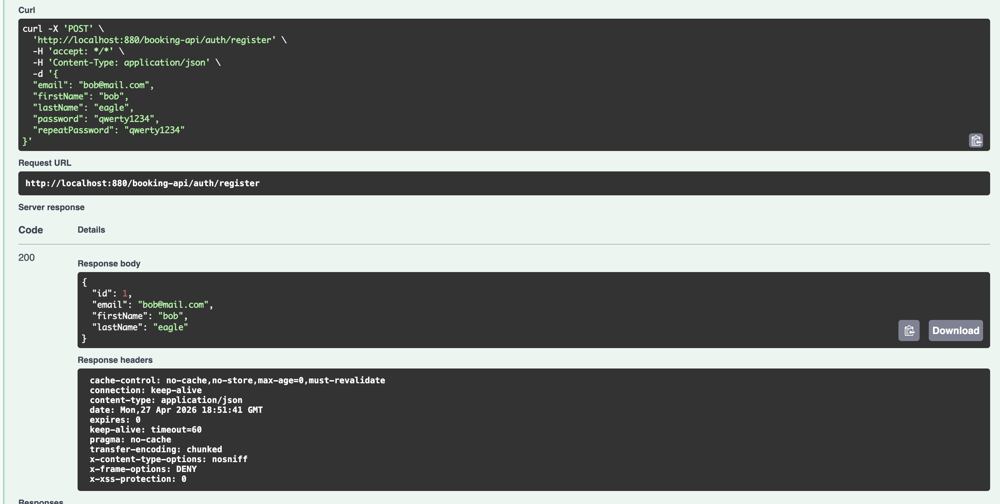

### Login with JWT token
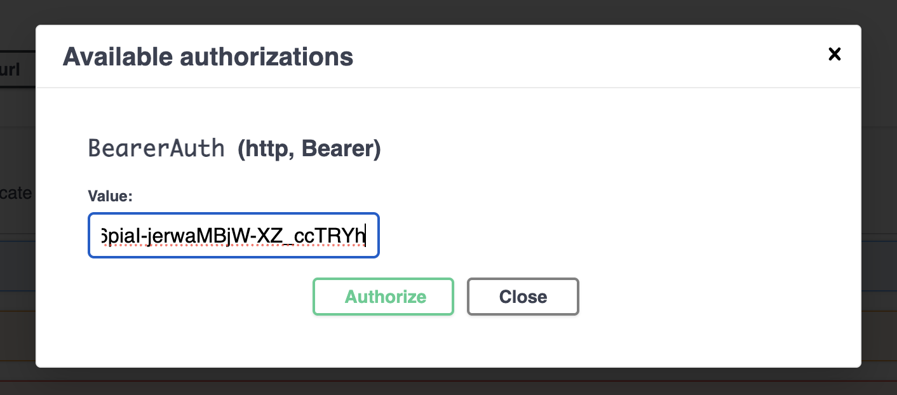

### Create Amenity 
**Input**
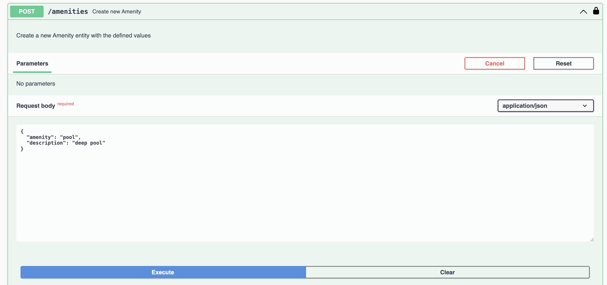
**Output**

User was not allowed to create a new amenity as it was not granted **MANAGER** authority.
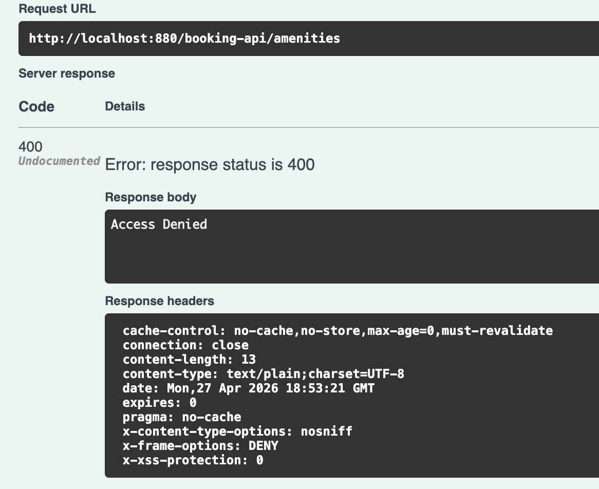
